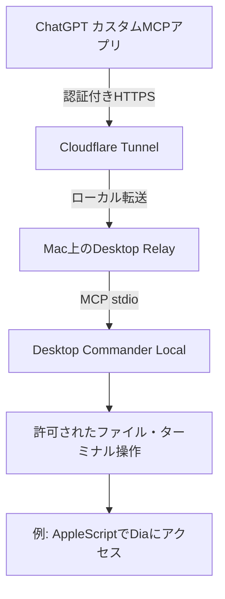

# ChatGPTからMacを操作する Desktop Relay 再現ガイド

[実験記録](docs/20261031-1451_M4実験記録.md) · [M1移植チェックリスト](docs/20261031-1451_M1移植チェックリスト.md) · [実機の切り分け表](docs/20261031-1451_検証境界.md)

[HashemKhalifa/desktop-relay](https://github.com/HashemKhalifa/desktop-relay) を使って、通常のChatGPTからmacOS上の **Desktop Commander Local MCP** を呼び出すための非公式・再現可能な手順です。

**このリポジトリはDesktop Relay本体のフォークではありません。** 本体は上流のMITライセンスのソフトウェアをそのまま使用します。利用者自身のMacで認証付きHTTPS中継を運用するため、公式READMEとSECURITYも必ず読んでください。

## 確認できたこと・できていないこと

2026年10月31日、M4 MacBook Airから接続したChatGPTのカスタムMCPアプリで `get_config` と `start_process` が成功しました。Mac上の `date`、`hostname`、さらに `osascript` による **DiaのタブURL一覧取得**まで確認できています。

- 実測：macOS / Apple Silicon、Node 24.22.2、Desktop Relay 0.2.0、Desktop Commander 0.2.52、上流Git commit `b8b64c8`。
- **未検証**：Diaのフォーム入力・送信、入力後／送信後のタブ保持、iPhoneのChatGPT、別のMacでの接続、再起動後の自動復旧。
- これはRemote Desktop Commanderの契約や月間利用枠を変更する仕組みではありません。**別のローカルMCPと自己管理の中継**です。ChatGPT側の制限・電気代・ドメイン代・クラウド利用料などは別に考えます。



## 導入前の要件

- macOS、Node.js **24以上**、pnpm **10**、Git、`cloudflared`。
- 安定稼働にはCloudflare管理下の自分のドメインと名前付きTunnel（上流推奨）。
- ChatGPTからカスタムMCPアプリを追加できる利用環境。プラン・組織ポリシーによって登録できない場合があります。
- Macが起動しログインしていること。Dia操作には、macOSが要求するAppleScriptの許可が必要です。

**実測した落とし穴：実験M4のRelayはNode 24で動作していましたが、通常Terminalの既定はNode 22・pnpm 12でした。** インストール時の実行PATHでNode 24以上とpnpm 10を必ず満たしてください。読み取り専用の検査スクリプトは両方のmajor versionを検査します。

**最初は読み取り専用ツールだけを公開してください。** Terminal実行はMac利用者とほぼ同等の影響を持つことがあります。

前提条件だけを確認する読み取り専用スクリプト：

```bash
bash scripts/check_prereqs.sh
```

## 1. 上流本体の取得

```bash
git clone https://github.com/HashemKhalifa/desktop-relay.git
cd desktop-relay
pnpm install --frozen-lockfile
```

実験時のソースと厳密に揃えるには `git checkout b8b64c8` を追加できます。ただし古い依存関係の安全性修正を見逃さないよう、実運用では上流の最新情報も確認してください。

## 2. HTTPS中継を構築する

以下は実験時に用いた一時TunnelのURLを写したものではなく、**上流が公開する継続運用向けの名前付きTunnelの手順**です。`mcp.example.com` は自分で管理するドメインに置き換えてください。

```bash
cloudflared tunnel login
cloudflared tunnel create desktop-relay
cloudflared tunnel route dns desktop-relay mcp.example.com
```

Tunnel UUIDが発行されたら、`~/.cloudflared/config.yml` をMac上で作ります。

```yaml
tunnel: <TUNNEL_UUID>
credentials-file: /Users/<MAC_USER>/.cloudflared/<TUNNEL_UUID>.json
ingress:
  - hostname: mcp.example.com
    service: http://127.0.0.1:8788
  - service: http_status:404
```

この設定とTunnel認証ファイルはGitHubへコピーしないでください。

## 3. Relayをセットアップして検収する

インストールスクリプトはMacにLaunchAgentを作るため、実行前に上流ソースを確認してください。

```bash
cloudflared tunnel ingress validate
./install.sh --edge cloudflare --domain mcp.example.com
scripts/verify.sh https://mcp.example.com
bin/dc-relayctl doctor
```

`doctor` でRelayの接続待受が `127.0.0.1:8788` に限定され、LANへ直接公開されていないことを確認します。接続できなければ次を調べます。

```bash
bin/dc-relayctl status
bin/dc-relayctl doctor
cloudflared tunnel info desktop-relay
```

Macのスリープ・ログアウト・ネットワーク切断中に利用できるとは限りません。

## 4. ChatGPT用の接続を作る

**URLの秘密部分自体が認証資格となります。** Mac上のターミナルでのみ発行し、表示された値をチャット、GitHub、CIログ、共有スクリーンショットへ貼らないでください。

まず読み取り用の例：

```bash
bin/dc-relayctl mint --name chatgpt-readonly --kind path-only --tools list_directory,read_file
```

上流バージョンで利用可能なツール名や指定方法は `bin/dc-relayctl` のヘルプで確認してください。

ChatGPTのカスタムMCPアプリ作成画面で、Macが表示した秘密URLを **Server URL** に設定します。「No authentication」と表示される場合も、URLパスに含まれる認証資格で照合されます。ここ以外に資格をコピーしないでください。

登録後、新しいチャットで該当アプリを選び、読み取りだけを試します。アプリ一覧で見えることと、**実ツール呼出が成功することは別**です。ツールの追加後はアプリの **Manage / Refresh tools** 等で新しい定義を取得し、再度新規チャットから確認します。

[上流のChatGPT接続手順](https://github.com/HashemKhalifa/desktop-relay#chatgpt) ／ [OpenAIカスタムMCPヘルプ](https://help.openai.com/en/articles/12584461-developer-mode-and-full-mcp-connectors-in-chatgpt)

## 5. 実際にMacを操作する場合

読み取りが実証できた後、対象のMac・許可範囲・リスクを確認して、必要な操作ツールだけを公開します。いきなり `--tools all` のような広い権限を付けることは推奨しません。

Diaブラウザを操作する場合は特に次を区別します。

1. AppleScriptの辞書が存在する・タブが読める。
2. 意図したDiaタブを開け、URLとタイトルを読み戻せる。
3. フォームへ入力し、その実画面を本人が確認できる。
4. 本人の承認に基づいて送信を一度だけ行う。
5. **送信後の成功・エラー画面を同じDiaタブに残せる。**

今回の実験では **1のみ検証済み** です。未完成のDia専用MCPアダプタを、使える機能として紹介していません。

## 6. セキュリティと公開禁止情報

- Mac側のユーザー権限で操作が行われます。許可したMCPツールが強ければ危険も大きくなります。
- トークンを含んだ完全URL、Tunnelの資格ファイル、Relayの `config.json` / `principals.json` / `dashboard.key`、ログ、ブラウザ履歴は公開しない。
- このリポジトリへ実際のMacホームパス・個人メール・個別のChatGPT接続URLは書かない。
- 端末の保護、HTTPS、認証、最小権限の公開、資格情報の失効手段、復旧手順をセットで設計する。
- 一時Tunnel（Quick Tunnel）は学習用に便利でも固定URL・常設運用を保証しません。
- 上流のリポジトリのMITライセンス表記を消して二次配布しない。
- まずテスト用フォルダと読み取り機能で確認し、送信・削除・支払いを伴う操作へ一足飛びに進まない。

## 他のMacへの展開

[M1移植チェックリスト](docs/20261031-1451_M1移植チェックリスト.md) にまとめました。**M4の秘密URLや資格ファイルはM1にコピーせず、M1専用に発行**します。

## English summary

Independent, non-official reproduction notes for connecting ChatGPT custom MCP to Desktop Commander Local on macOS using the open-source [Desktop Relay](https://github.com/HashemKhalifa/desktop-relay). Tested: one Apple Silicon Mac, remote commands and Dia tab enumeration via AppleScript. Not yet tested: a second Mac, iOS, form submission or browser-state persistence. Treat credential-bearing endpoint URLs as secrets.
