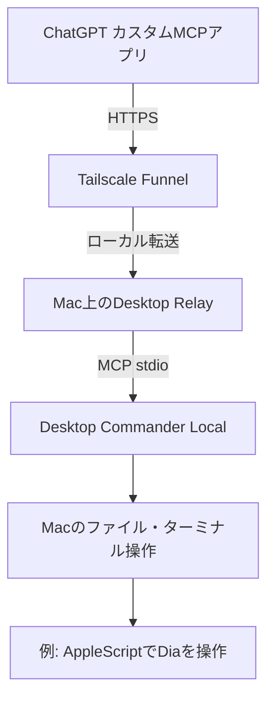

# ChatGPTからMacを操作する Desktop Relay 再現ガイド

[実験記録](docs/20261031-1451_M4実験記録.md) · [2台目のMacへの追加](docs/20261031-1451_M1移植チェックリスト.md) · [確認の切り分け表](docs/20261031-1451_検証境界.md)

[HashemKhalifa/desktop-relay](https://github.com/HashemKhalifa/desktop-relay) を使い、通常のChatGPTからMac上の **Desktop Commander Local MCP** を呼び出す非公式の手順です。本体は上流のMITライセンスのソフトウェアをそのまま使います。

できあがる使い方は次の2つだけです。

```bash
desktop-relay       # 起動。Ctrl+C で停止
desktop-relay url   # ChatGPT に登録する URL をクリップボードへ
```

常駐はしません。ドメインも不要です。使う時だけターミナルで起動します。



## 必要なもの

- macOS（Apple Silicon）、Git
- Tailscale（CLIを使える状態でログイン済み）
- カスタムMCPアプリを追加できるChatGPT

これはRemote Desktop Commanderの契約や月間利用枠を変える仕組みではなく、別のローカルMCPと自前の中継です。

## 1. 導入

Node 24.22.2は専用フォルダに置くので、普段のNodeやHomebrewには影響しません。

```bash
R="$HOME/.local/share/desktop-relay"
mkdir -p "$R/node"
curl -fsSL https://nodejs.org/dist/v24.22.2/node-v24.22.2-darwin-arm64.tar.gz \
  | tar xz -C "$R/node" --strip-components=1

git clone https://github.com/HashemKhalifa/desktop-relay.git "$R/app"
git -C "$R/app" checkout b8b64c8
cd "$R/app"
PATH="$R/node/bin:$PATH" COREPACK_HOME="$R/corepack" \
  COREPACK_ENABLE_DOWNLOAD_PROMPT=0 PUPPETEER_SKIP_DOWNLOAD=1 \
  corepack pnpm install --frozen-lockfile
```

このリポジトリの [`scripts/desktop-relay`](scripts/desktop-relay) を、PATHの通った場所へ置きます。

```bash
mkdir -p ~/.local/bin
curl -fsSL https://raw.githubusercontent.com/k1nyA/chatgpt-desktop-relay-repro/main/scripts/desktop-relay \
  -o ~/.local/bin/desktop-relay
chmod +x ~/.local/bin/desktop-relay
```

`~/.local/bin` がPATHにない場合は、シェルの設定に追加します。上流の `install.sh` はLaunchAgentを作るので、この手順では使いません。

## 2. 起動してURLを出す

```bash
desktop-relay
```

初回の起動で全ツール用のURLが発行され、固定で保存されます。TailscaleがFunnelの承認を求めた時は、表示されたURLをブラウザで開いて許可します。

別のターミナルで次を実行します。

```bash
desktop-relay url
```

URLがクリップボードに入ります。

## 3. ChatGPTに登録する

1. ChatGPTのカスタムMCPアプリ作成画面を開きます。名前は `DesktopRelayM1` のようにMacが分かるものにします。
2. Server URLにURLを貼り、認証は「No authentication」を選びます。URLの中に認証情報が入っています。
3. 新しいチャットでアプリを選び、「`hostname` を実行して」と頼みます。

ツールの定義を更新した時は、アプリの **Manage / Refresh tools** のあと新しいチャットで確認します。

## 4. 止める

起動したターミナルで Ctrl+C を押します。Relay本体とFunnelの公開が一緒に止まります。URLは次の起動でそのまま使えます。

## Diaを操作する場合

Diaのページ上でJavaScriptを実行するには、起動フラグが必要です。

```bash
open -a /Applications/Dia.app --args --enable-applescript-javascript
```

Diaが起動中の時はフラグを後付けできないので、一度終了してから実行します。

M1/M4とも2026-10-31にDockのDiaタイルを `~/Applications/Dia Launcher.app` へ置換済み。普段はDockから起動するだけでフラグが付きます。ターミナルから同じランチャーを起動するなら：

```bash
open -a "$HOME/Applications/Dia Launcher.app"
```

[Dia本体の操作手順・検証結果](https://github.com/k1nyA/dia-browser-ops/blob/main/docs/OPERATIONS.md)を参照してください。2026-10-31、両Macで7項目のローカルテストフォーム入力・読み戻し・タブ維持・送信0回を確認し、Dia専用MCP実装を`k1nyA/dia-browser-ops/main` の`e4424a9`へ統合。さらにM4では実際のUTAGE申込フォームも入力・読戻し済み（送信は本人が実施し、後からLINE受付返信を確認）。**これはブラウザ操作の実証であり、ChatGPTの定期実行での継続アクセスやLINE拡張画面の読取を保証しません。**

## 知っておくこと

- URL自体が鍵です。チャット、GitHub、スクリーンショットに載せないでください。全ツール用のURLなので、知っている人はMacのファイル操作と端末実行ができます。
- 漏れた時は `bin/dc-relayctl revoke` で失効させ、`~/.config/desktop-relay/chatgpt-url` を消して起動し直すと新しいURLになります。
- Desktop Commanderは `~/.claude-server-commander` の設定を共有します。同じMacでRemote Desktop Commanderを動かしている場合は、先に `config.json` を控えておくと安心です。
- 起動中でも、Macのスリープやネットワーク切断の間は使えません。

## 確認状況（2026-10-31）

| 項目 | M4 | M1 |
| --- | --- | --- |
| 構成 | Quick Tunnel（試験時） | Tailscale Funnel＋本コマンド |
| Mac内のMCP呼び出し（`start_process` まで） | 成功 | 成功 |
| ChatGPTへの登録・接続 | 成功 | 成功 |
| ChatGPTからの読取ツール実行 | 成功 | 成功 |
| ChatGPTからの端末実行 | 成功 | 成功 |
| Dia操作 | AppleScript＋JavaScriptで実フォームの読み取り・入力・検証成功 | 同左（ローカルテストフォーム） |
| iPhoneの通常チャット | 未確認 | 未確認 |

実測：macOS 15.7.1 / Apple M1、Node 24.22.2、Desktop Relay 0.2.0（`b8b64c8`）、Desktop Commander 0.2.52、Tailscale 1.104.1。

## English summary

Independent, non-official notes for connecting ChatGPT custom MCP to Desktop Commander Local on macOS with the open-source [Desktop Relay](https://github.com/HashemKhalifa/desktop-relay), Tailscale Funnel and a small foreground command: `desktop-relay` starts it, Ctrl+C stops it, `desktop-relay url` copies the connector URL. The URL grants all tools, so treat it as a secret.
